# GCP Cloud DevOps Engineer – Solution

Batya Kopelowitz. Assignment: [assignment/ASSIGNMENT.md](assignment/ASSIGNMENT.md)

## Solution

1. [Service interruptions](solution/SOLUTION1.md)
2. [Backup and recovery](solution/SOLUTION2.md)
3. [Linux pipeline agent](solution/SOLUTION3.md)
4. [Failed release](solution/SOLUTION4.md)
5. [Git controls](solution/SOLUTION5.md)

## Notes

- **Tested:** Problem 5 – the branch and pull request flow, on this repository. Everything else is proposed only.
- **Time spent:** about 1–2 hours per problem.
- **AI:** I mainly used Claude, and a little ChatGPT, to explain concepts, ask questions, guide my investigation flow, clarify things I did not know and improve my English.
